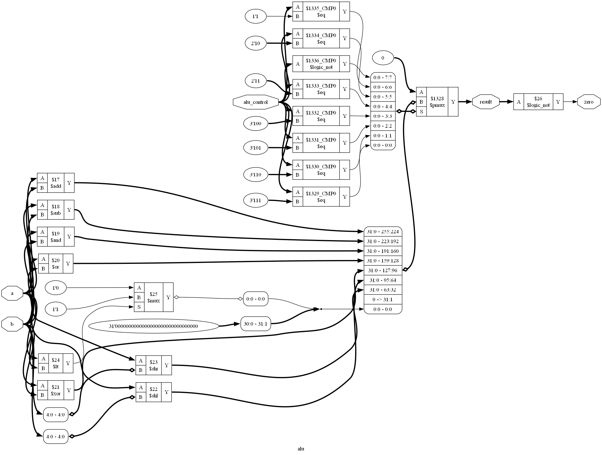

# 5-Stage Pipelined RISC-V Processor (Verilog)

A 5-stage pipelined RISC-V CPU in Verilog HDL, with data forwarding and hazard detection, verified in simulation and synthesized with Yosys.

   

## Highlights

- Classic IF → ID → EX → MEM → WB pipeline with IF/ID, ID/EX, EX/MEM and MEM/WB pipeline registers
- **Forwarding unit** resolves RAW data hazards without stalling where possible
- **Hazard detection unit** inserts stalls for load-use hazards
- Separate instruction and data memory, register file, ALU, immediate generator and control unit
- Self-checking testbench with a load-use hazard test and CPI/stall/forwarding counters, GTKWave waveforms, Yosys RTL schematic

## Supported instructions

RV32I subset: R-type `add sub and or xor sll srl slt`, I-type `addi andi ori xori slli srli slti`, `lw`, `sw`, and `beq`. Not yet implemented: `bne/blt/bge` (decoded as `beq`), `sra/srai`, `sltu/sltiu`, `jal/jalr`, `lui/auipc`, byte/half-word loads and stores.

## Architecture

| Stage | What it does |
|---|---|
| IF | Fetches the instruction and computes the next PC |
| ID | Decodes, generates control signals, reads registers, builds the immediate |
| EX | ALU operation; forwarded operands selected here |
| MEM | Data-memory load/store |
| WB | Writes the result back to the register file |



## Repository layout

| File | Module |
|---|---|
| `riscv_5stage.v` | Top level |
| `if_id.v`, `id_ex.v`, `ex_mem.v`, `mem_wb.v` | Pipeline registers |
| `alu.v`, `control_unit.v`, `register_file.v`, `immediate_generator.v` | Datapath and control |
| `forwarding_unit.v`, `hazard_detection.v` | Hazard handling |
| `instruction_memory.v`, `data_memory.v` | Memories |
| `tb_riscv_5stage.v` | Testbench |
| `tb_*.v` | Unit testbenches for each module |
| `riscv_schematic.png`, `riscv_waveform.png`, `RICSwave.gtkw` | Schematic, waveform screenshot, GTKWave save file |

## Run it

Requires Icarus Verilog, GTKWave and Yosys.

```bash
# Simulate
iverilog -g2012 -o riscv_sim alu.v control_unit.v data_memory.v ex_mem.v forwarding_unit.v \
  hazard_detection.v id_ex.v if_id.v immediate_generator.v instruction_memory.v \
  mem_wb.v register_file.v riscv_5stage.v tb_riscv_5stage.v
vvp riscv_sim            # prints: ALL PIPELINE TESTS PASSED

# View waveforms
gtkwave riscv_5stage.vcd
```

```text
# Synthesize (inside yosys)
read_verilog alu.v control_unit.v data_memory.v ex_mem.v forwarding_unit.v hazard_detection.v id_ex.v if_id.v immediate_generator.v instruction_memory.v mem_wb.v register_file.v riscv_5stage.v
prep -top riscv_5stage
check                    # Found and reported 0 problems
write_verilog -noattr riscv_synth.v
show -format dot -prefix riscv_schematic
```

## Results

- Testbench passes; pipeline, register and memory signals inspected in GTKWave
- Yosys synthesis completes with 0 reported problems; gate-level netlist and schematic generated

## Next steps

- Flush IF/ID and ID/EX on a taken branch (today the two wrong-path instructions after a taken `beq` still execute)
- Remaining RV32I instructions and branch prediction
- Wider instruction coverage against the RV32I compliance tests
- Take the core through OpenLane/LibreLane on SKY130

## Author

**Rahul Dayanand Gunari**, B.E. Electronics & Communication, Sri Venkateshwara College of Engineering, Bengaluru
[LinkedIn](https://www.linkedin.com/in/rahul-gunari-b31350312/) · gunarirahuld@gmail.com
